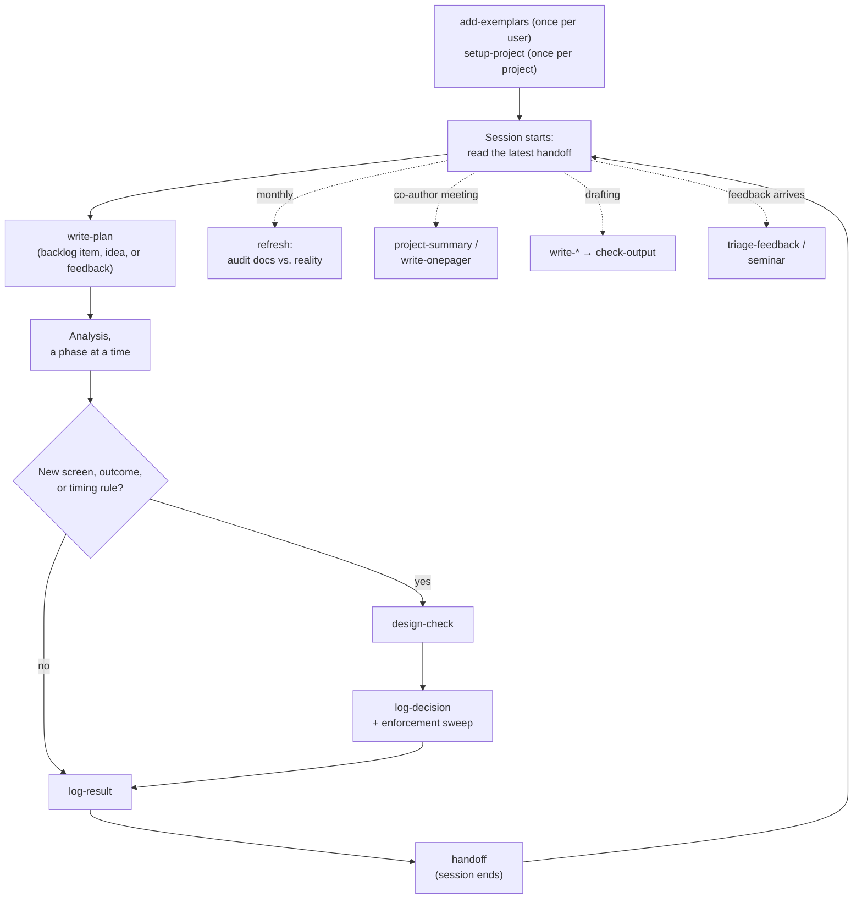

# The workflow

AI coding agents make empirical work faster. They also make four failures more likely:

1. **Settled decisions get re-litigated**, because the agent does not remember why an
   approach was dropped.
2. **Conventions do not travel**: a rule learned in one repository is violated in the
   next.
3. **Stale numbers reach co-authors**: a coefficient from an old run survives in a
   draft, a slide, or a status line.
4. **A lost session loses the thread**: a closed conversation (or a lost laptop)
   takes the working state with it.

This kit's answer is a small set of **documents of record**, each with an explicit
rule for who writes it and how it may change, plus skills that keep them current.

## Documents of record

| Document | Holds | How it changes | Written by | Read by |
|---|---|---|---|---|
| `CLAUDE.md` | how to work in this project; current status | living — the Status section is stamped by `refresh` | you, `setup-project`, `refresh` | every session |
| `docs/key-decisions.md` | ratified and provisional decisions | append-only | `log-decision` | every skill, before proposing alternatives |
| `docs/results-log.md` | the numbers of record | append-only | `log-result` | writing skills, `check-output`, `project-summary` |
| `docs/dropped-analyses.md` | abandoned approaches and why | append-only | `log-decision`, you | `write-plan`, `seminar`, `triage-feedback`, `explore-directions` |
| `docs/backlog.md` | open work, by ID | living | `sync-state`, `write-plan`, you | `write-plan`, `sync-state`, `write-onepager` |
| `plans/{goal}_{date}.md` | a phased plan, results appended per phase | append-only | `write-plan`, you | `sync-state`, `refresh` |
| `handoffs/{date}-{topic}.md` | where a session left off | immutable | `handoff` | the next session |
| dated project summaries | a self-contained orientation for co-authors | immutable | `project-summary` | co-authors |
| feedback triage docs | referee and seminar comments, binned | immutable | `triage-feedback` | you |
| `.claude/rules/skill-bindings.md` | paths and settings the skills use | living | you, `setup-project` | every skill |

Two rules hold across all of them:

- **One home per fact.** Numbers live in the results log and the generating CSV;
  plans, memos, and status lines point there instead of copying. Drafts and slides
  are the exception — they must carry numbers — which is why `check-output` exists.
- **Records are not rewritten.** Append-only documents are never reworded or
  renumbered; a reversal is a new entry that references the old one. Immutable
  documents are superseded by a new dated file.

## Bindings

The skills are generic. Each looks up project specifics — which results log is
authoritative, which output directories count as the record, where drafts go, how to
compile LaTeX, which seminar panel fits the paper — in the project's `CLAUDE.md` and
`.claude/rules/skill-bindings.md`, and falls back to defaults when a value is absent.
`setup-project` creates the bindings file with every field documented.

## A project's life

In words: build your style profile once with `add-exemplars` and set each project up
once with `setup-project`; start each session from the latest handoff; turn
the next backlog item, idea, or piece of feedback into a dated plan with `write-plan`;
run the analysis a phase at a time, appending results to the plan and logging them as
they appear; put any new definition
through `design-check` before adopting it, then record it with `log-decision`; end
each session with `handoff`. Periodically, `refresh` audits the documents against the
repository. Before a meeting, `project-summary` or `write-onepager` compiles the record
for an outside reader.

## Integrity checks built in

| Check | Catches |
|---|---|
| `design-check` | screens or outcomes biased by construction: conditioning on post-treatment information, measures with a built-in time trend, units included in their own aggregates |
| `blast-radius` | a data-layer bug fixed at one call site but still read elsewhere |
| `check-output` | numbers in a draft, deck, or one-pager that no longer match the output files |
| `log-decision`'s sweep | a banned pattern that survives in the code after the decision banning it |
| `refresh` | documents that drifted from the repository: stale status, unrecorded decisions, dead pointers |
| `explore-directions` | specification search: every new direction is pre-registered with a kill condition before any code runs |

These checks flag; they do not decide. `design-check`, `seminar`, and
`explore-directions` work from your documents, not your expertise: expect flags that
do not apply and misses that do. You rule on every flag.
